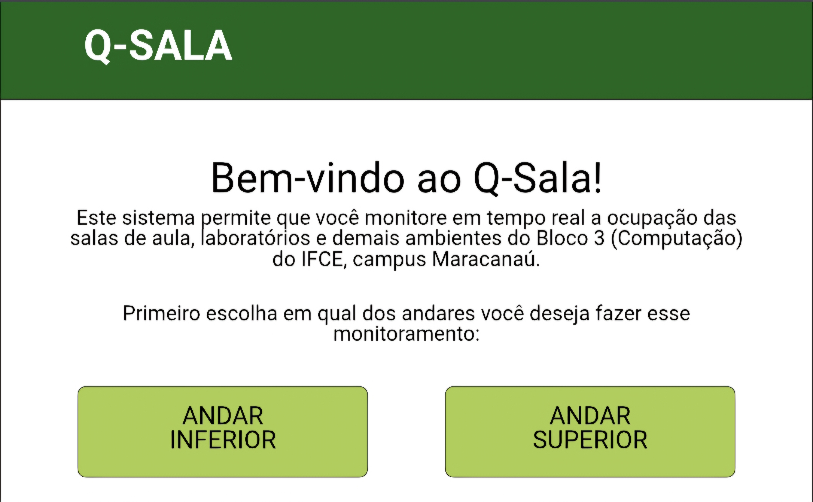
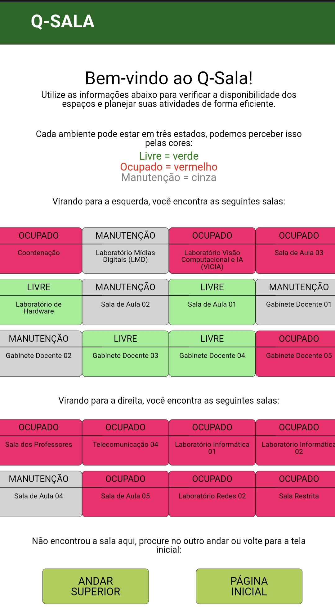
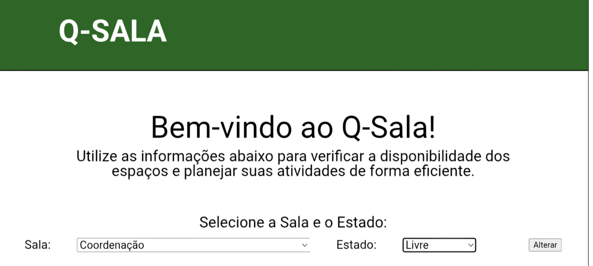

# 🏫 Classroom Monitor System

Sistema web para visualização e monitoramento da disponibilidade de salas de aula.

## 📌 Sobre

Este projeto foi desenvolvido individualmente durante a disciplina de Desenvolvimento Web I, no curso Técnico em Informática do Instituto Federal do Ceará (IFCE).

A proposta surgiu da ideia de criar uma ferramenta para representar a disponibilidade das salas do Bloco 3 do campus, permitindo identificar quais espaços estavam disponíveis ou ocupados.

O projeto foi desenvolvido em duas versões, apresentando uma evolução na interação com os estados das salas.

## 🖥️ Preview

Versão 1 — Visualização dos ambientes

Nesta versão, o sistema permite visualizar a situação das salas, sem possibilitar a alteração de seus estados.

Versão 2 — Alteração dos estados

Nesta versão, foi implementada a possibilidade de alterar o estado de disponibilidade das salas.

## ✨ Funcionalidades

- Visualização das salas do Bloco 3.
- Identificação dos estados de disponibilidade.
- Consulta visual da situação dos ambientes.
- Alteração manual dos estados na segunda versão.

## 🛠️ Tecnologias utilizadas

- HTML5
- CSS3
- JavaScript

## 🔄 Evolução do projeto

### Versão e mudanças
- 1.0: Visualização dos estados das salas
- 2.0: Possibilidade de alterar os estados

## 📚 Aprendizados

- Desenvolvimento de interfaces web.
- Manipulação de elementos HTML com JavaScript.
- Interatividade e atualização de estados.
- Organização de informações em uma interface.
- Evolução de funcionalidades entre versões.

## 🎯 Contexto acadêmico

- Instituição: IFCE
- Curso: Técnico em Informática
- Disciplina: Desenvolvimento Web I
- Modalidade: Individual

## 🌐 Acesse o projeto

🔗 Site:
- Versão 1: https://esthefanysouza.github.io/Classroom-Monitor-System/primeiraversao/inde.html
- Versão 2: https://esthefanysouza.github.io/Classroom-Monitor-System/segundaversao/index.html
💻 Código: https://github.com/esthefanysouza/Classroom-Monitor-System

## 👩‍💻 Autoria

Desenvolvido por Esthefany Souza.
